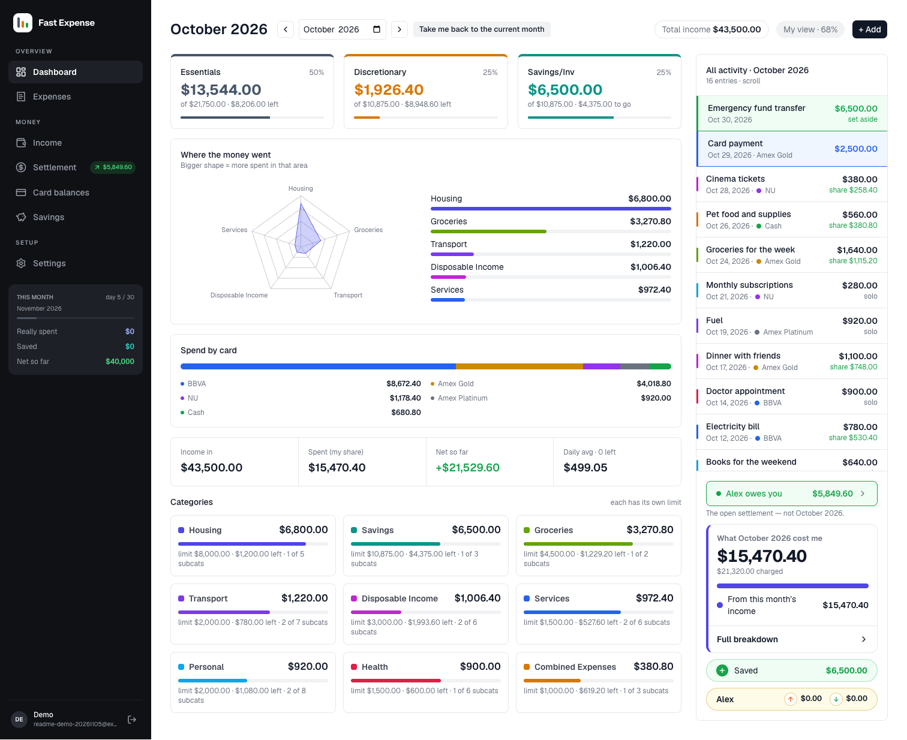
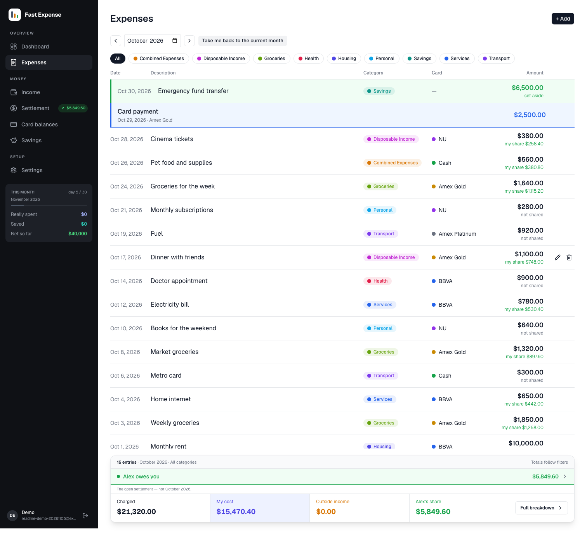
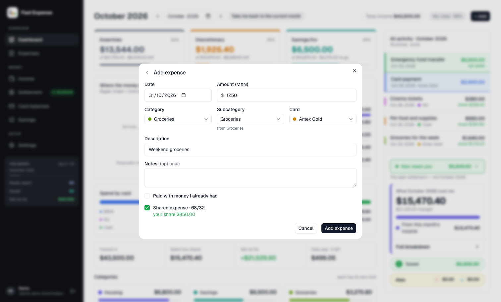

# Fast Expense Tracker

Fast Expense Tracker is a personal expense tracker for MXN spending and shared expenses. It records each expense, applies your saved share to shared spending, and shows monthly budgets, card balances, and partner settlement totals. All data shown in the screenshots below is invented demo data.

## Screenshots



| Expenses                                                               | Add an expense                                        |
| ---------------------------------------------------------------------- | ----------------------------------------------------- |
|  |  |

See [screenshot provenance and refresh instructions](docs/screenshots/README.md).

## What it does

- Tracks expenses by category, subcategory, card, date, and shared or personal status.
- Counts your saved percentage of shared expenses in spending totals.
- Compares spending with monthly category budgets and 50/25/25 budget targets.
- Tracks income, card balances, card payments, and partner settlement activity.
- Supports English and Spanish.

## Stack

Next.js 16 with React 19 and TypeScript, PostgreSQL 17, Prisma 6, Auth.js, Tailwind CSS 4, and Recharts.

## Run locally

You need Node.js 24, pnpm, and Docker with Docker Compose.

```sh
pnpm install
pnpm db:up
cp .env.example .env.local
```

The local database URLs in `.env.example` already point to the Docker database on port `5433`. Keep `DATABASE_URL` and `DATABASE_URL_UNPOOLED` set to those local values. In `.env.local`, set `AUTH_SECRET` to a generated value, set `AUTH_URL` to `http://localhost:3000`, and choose `ADMIN_EMAIL` and `ADMIN_PASSWORD` for your local login. Generate the secret with:

```sh
openssl rand -base64 32
```

Apply the schema and create your local user and starter data:

```sh
pnpm db:migrate
pnpm db:seed
```

To load optional invented expenses for the dashboard and lists, run `pnpm db:seed:dev` after the first seed. This resets that local user's expenses and movements before it adds demo data. Use it only with the local database.

Start the app:

```sh
pnpm dev
```

Open [http://localhost:3000](http://localhost:3000) and sign in with the admin email and password you configured.

## Useful commands

| Command          | Purpose                            |
| ---------------- | ---------------------------------- |
| `pnpm db:down`   | Stop the local database container. |
| `pnpm lint`      | Run ESLint.                        |
| `pnpm typecheck` | Run TypeScript checks.             |
| `pnpm test`      | Run the Vitest suite.              |
| `pnpm build`     | Build the app for production.      |

For database and deployment details, see [local and external setup](docs/operations/setup.md). The [roadmap](docs/roadmap/README.md) tracks current work, and the [agent workflow](docs/conventions/agent-workflow.md) explains how changes are made and reviewed. This is an agent-led project. Christian reviews agent changes; see [AGENTS.md](AGENTS.md) for contributor instructions. The [initial design](docs/specs/0001-initial-design.md) describes the project goals. The repository has no license for reuse.
