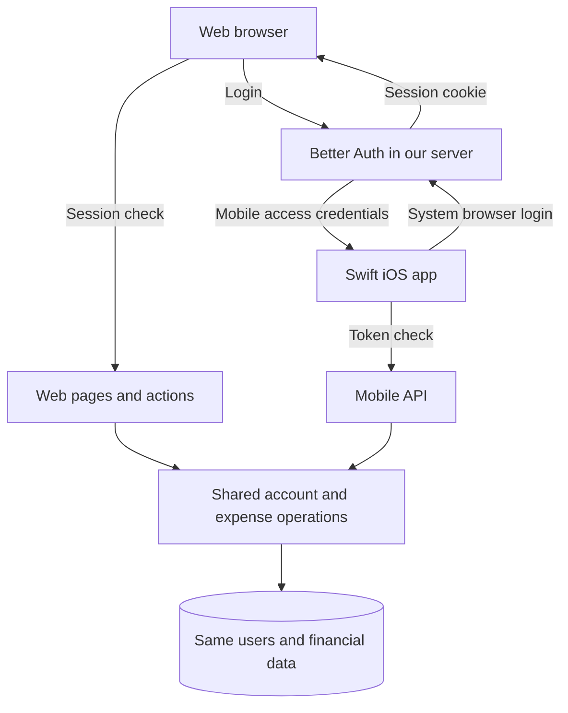
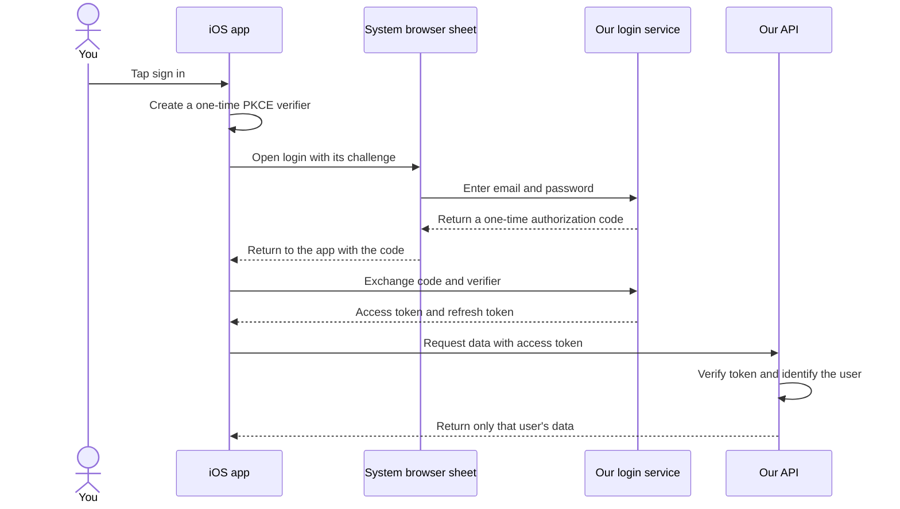
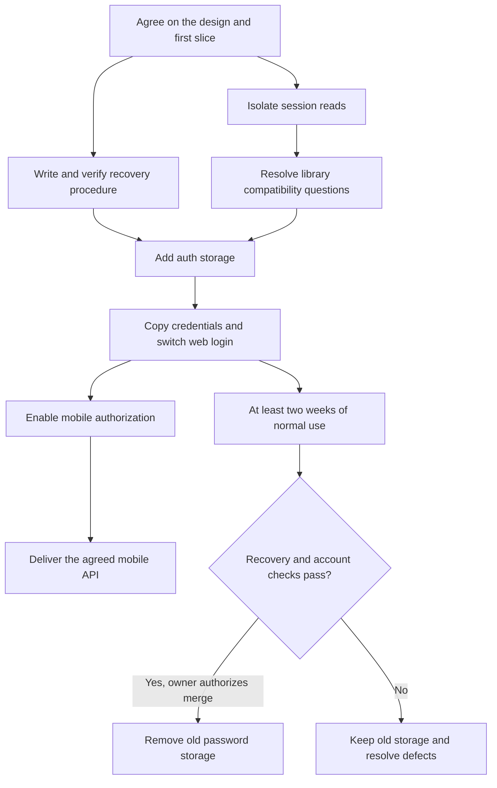

# Web and iOS login

Status: design approved by Christian on 2026-10-29. Delivery planning is next.

[Open the visual HTML edition](2026-10-24-auth-design-review.html).

[Review the delivery plan](2026-10-29-auth-delivery-plan.html) for the slice order,
acceptance checks and production gates.

We want a native Swift iOS app to use the same account and expense data as the web.
The web currently signs users in through Auth.js and a browser cookie. The existing
design replaces that login service with Better Auth, then adds a standard mobile
login flow. We will finish this repo's auth service first. The mobile repo will
define the expense APIs with its first app journey.

Christian confirmed native Swift iOS first on 2026-10-24. The app should ask for
login initially and use Face ID for later unlocks. The mobile repo owns that UX,
its fallback rules and its implementation plan. Christian approved this design
on 2026-10-29. Technical questions below remain gates for the affected slices.

## What changes for you

On the web, you keep the login screen and password. The migration would ask you
to sign in once again. The proposed web session still expires after 30 minutes
without activity. Simply leaving a dashboard open must not keep it signed in.

On iOS, the app opens the service's login page in a system browser sheet. After
login, the sheet returns you to the app. The app receives credentials for API
requests, while your password stays on the login page. This follows the native
app approach in [RFC 8252](https://www.rfc-editor.org/rfc/rfc8252.html).

The auth service must support persistent, renewable mobile sign-in. Face ID is
the app's local unlock step; it does not replace server credential checks.
Exact token lifetimes and revocation rules remain technical design decisions
here. The mobile repo owns prompts, fallback behavior and reauthentication UX.

Today, the web is the only client:

With the proposed change, both clients reach the same account and money rules:

## Why replace the login service

The proposal keeps our identities and passwords in the existing database. It also
gives us database-backed web sessions and an OAuth provider in one service.
The [Better Auth provider documentation](https://better-auth.com/docs/plugins/oauth-provider)
supports the proposed mobile authorization flow. Its exact behavior still needs
verification against the version we choose.

| Approach                                                | What we gain                                                      | What we take on                                                         |
| ------------------------------------------------------- | ----------------------------------------------------------------- | ----------------------------------------------------------------------- |
| Better Auth inside our app, proposed                    | One login service for web and mobile; existing database ownership | Auth migrations, provider upgrades, recovery and signing-key management |
| Keep Auth.js and add a separate mobile identity service | Smaller immediate change to web login                             | Two session systems and a reliable link between their identities        |
| Move to a hosted identity provider                      | Provider operates the identity service                            | Another service, account migration, pricing and integration decisions   |

I recommend we keep Better Auth as the candidate and prove compatibility before
the schema work. The mobile requirement motivates the change; the migration
guide also says an existing working Auth.js setup does not require an urgent
move. See the [official migration guide](https://better-auth.com/docs/guides/next-auth-migration-guide).

## Next change: let the phone sign in

The phone needs a way to prove who made each request. The proposed flow uses a
short-lived access token for requests and a separate refresh token to renew access.
PKCE binds the login code to the app that started the login, so possession of the
code alone is insufficient to exchange it.

How the first mobile login would work:

The server must still check ownership for each read and write. Signing in never
grants access to another user's expense, card, or category. The server continues
to calculate financial totals for both clients.

Agent notes: mobile protocol

- Use an authorization-code flow with S256 PKCE and a public client without a secret.
- Enforce the registered redirect URI. Confirm the app identifier, callback scheme,
  issuer URL, scopes, audience and state validation before client registration.
- The existing proposal uses signed JWT access tokens, verified through JWKS.
  Validate issuer, audience, expiry, allowed algorithms and required scopes.
  Use the verified subject as the user id. Reject ID tokens as API credentials.
- Use iOS Keychain for refresh-token storage. The Swift client-library choice,
  rotation concurrency, lost refresh responses and retry behavior need verification.
- Decide whether mobile refresh credentials survive expiry of the browser session
  that created them. A 30-minute browser timeout must not accidentally invalidate
  the agreed mobile sign-in duration.
- The current provider docs describe refresh-token reuse intervals. The old spec's
  blanket claim that every reuse revokes the whole family needs a version-specific
  test. Do not encode the claim as proven behavior.

## Next change: migrate without losing accounts

We add the new auth storage before we switch login. Existing user identities and
financial records stay intact. We copy password hashes into the new credential
storage; nobody needs to reset their password for the migration.

The old password storage remains during an observation period. A rollback must
work for passwords changed and accounts created during that period too. Keeping
only the original hashes would not provide that guarantee.

The architecture below shows the long-term path. The delivery plan ends this
repo's current phase with a tested auth contract; business APIs wait for mobile planning.

Before a production schema step, Christian verifies the restore procedure and
takes the agreed restore point. Christian merges each PR. A code rollback does
not reverse a database migration.

Agent notes: migration and rollout gates

- Retain existing User ids, normalized emails and financial foreign keys.
  No auth migration changes money tables or stored financial calculations.
- Backfill each eligible user once, in a transaction. Check for missing users,
  duplicate credential accounts and hash mismatches per user. Matching aggregate
  counts alone cannot prove that each user has the correct credential row.
- Before switching, decide how signup, seed/provisioning, password change and
  manual password recovery keep both credential stores consistent. Demonstrate
  rollback using an invented user created or changed after the switch.
- Preserve signup's gate, cap and complete starter-account provisioning. Direct
  provider endpoints must not bypass these application policies.
- Keep passive reads from renewing idle sessions. Better Auth documents
  `disableSessionRefresh`; our explicit renewal and cross-tab races still need
  tests against the pinned version. See the [options reference](https://better-auth.com/docs/reference/options).
- CHORE-34 precedes schema work. CHORE-8.e is merged in PR #97.
  The recovery runbook and auth migration survey runbook are not complete.
- The current execution plan says CHORE-33 may ship on Auth.js. Spec 0009 says
  to build it after the Better Auth switch. Reconcile that sequence before coding.

## Scope and rough size

This is a large migration with separate review and production checkpoints. It
does not qualify for immediate implementation from a short task description.

| Stage                                        | Relative size                  | What makes it complete                                                |
| -------------------------------------------- | ------------------------------ | --------------------------------------------------------------------- |
| Session boundary                             | Small                          | Existing reads use our boundary; behavior stays the same              |
| Compatibility proof and recovery preparation | Medium                         | Open library questions have evidence; recovery steps are usable       |
| Auth storage expansion                       | Medium                         | Migration preserves invented existing users and financial rows        |
| Web login switch                             | Large                          | Login, signup, idle expiry, logout and rollback pass full-flow checks |
| Mobile authorization                         | Large                          | Registered client completes login, renewal and rejection cases        |
| Mobile API                                   | Not estimated yet              | We first choose which mobile screens and operations launch            |
| Old storage cleanup                          | Small change, high consequence | Observation period and per-user surveys pass; owner authorizes merge  |

For planning, allow roughly **6 to 12 focused engineering days for auth and mobile
authorization**, excluding API feature work, the Swift app, and the observation
period. This is an unmeasured engineering estimate, not an elapsed-time promise
for Codex. It assumes we retain the proposed provider, work serially, reuse the
web design, and encounter no blocking library issue. We will revise it after
the compatibility proof and estimate each approved slice separately.

The existing plan has six delivery stages. The API stage may need several small
PRs. Cleanup waits at least two calendar weeks after the web switch, regardless
of how quickly implementation finishes.

## Open items

1. **Coordinator:** define persistent mobile sessions and renewal, with explicit
   expiry and revocation rules. The agreed product direction is initial login
   followed by Face ID unlocks; detailed mobile UX belongs in the mobile repo.
2. **Christian and coordinator:** define whether normal logout ends only the
   current device, and whether password change or recovery ends every device.
   Proposed behavior: current-device logout, all-device password revocation.
3. **Mobile repo planning:** choose the first mobile journey there. This repo's
   API estimate waits for that agreed contract; mobile screen planning stays there.
4. **Coordinator:** resolve version, credential compatibility, atomic provisioning,
   idle renewal, rollback writes, refresh rotation, session linkage and key rotation.
   These are technical checks, not questions Christian needs to answer from memory.
5. **Coordinator:** complete the compatibility investigation before the first
   auth schema change. CHORE-39 merged in PR #102 after independent review.

## What is verified

The existing app uses Auth.js Credentials, bcrypt verification and a browser JWT
session. The schema keeps password hashes on the user. The accepted repo proposal
targets Better Auth and an iOS OAuth client. Native Swift iOS first is confirmed
for this planning discussion.

The proposed provider integration, mobile lifetime and rollback guarantees have
not been proven. No production auth migration has run in this session.

Tests and acceptance plan

- Existing users keep their identities and passwords. Legacy short passwords and
  normalized email lookups still work. Failure messages do not reveal account existence.
- The web expires after the agreed idle interval. Passive requests, background
  tabs and a late renewal cannot silently extend or revive an expired session.
- A new account receives its full starter data. Closed signup and the user cap
  hold through every public signup entry point.
- Every API read and write rejects another user's resource ids, independent of
  client-supplied identity fields. Invalid, expired or misdirected tokens fail closed.
- Test wrong PKCE verifier, wrong redirect, code reuse, refresh rotation and retry,
  revocation, lost network responses, and signing-key changes.
- Before switching, exercise rollback after signup and password writes. Test data
  migrations with invented records and per-user comparisons.
- Each approved slice uses an implementer subagent and a separate reviewer.
  User-visible auth flows also receive headless browser verification and evidence.

Sources and earlier decisions

- [Existing spec 0009](../specs/0009-auth-module-better-auth.md)
- [Better Auth decision](../decisions/0027-replace-authjs-with-better-auth.md)
- [Native client decision](../decisions/0028-native-clients-use-oauth-with-pkce.md)
- [Current execution plan](../roadmap/execution-plan.md)
- [OAuth provider documentation](https://better-auth.com/docs/plugins/oauth-provider)
- [Session management](https://better-auth.com/docs/concepts/session-management)

---

For agents: current checkout and planning boundary

Reader: Christian, who needs to review the auth architecture and delivery risks.

The main session owns planning and task briefs. Product implementation and
independent review belong to separate subagents. Christian approved the design
on 2026-10-29 and merged [CHORE-39](https://github.com/Chrisgmsl22/fast-expense-tracker/pull/102).
Its scope, review and checks are preserved in the PR description.

