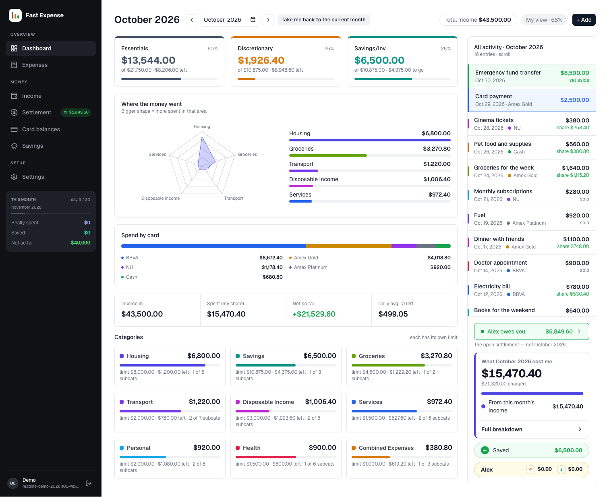
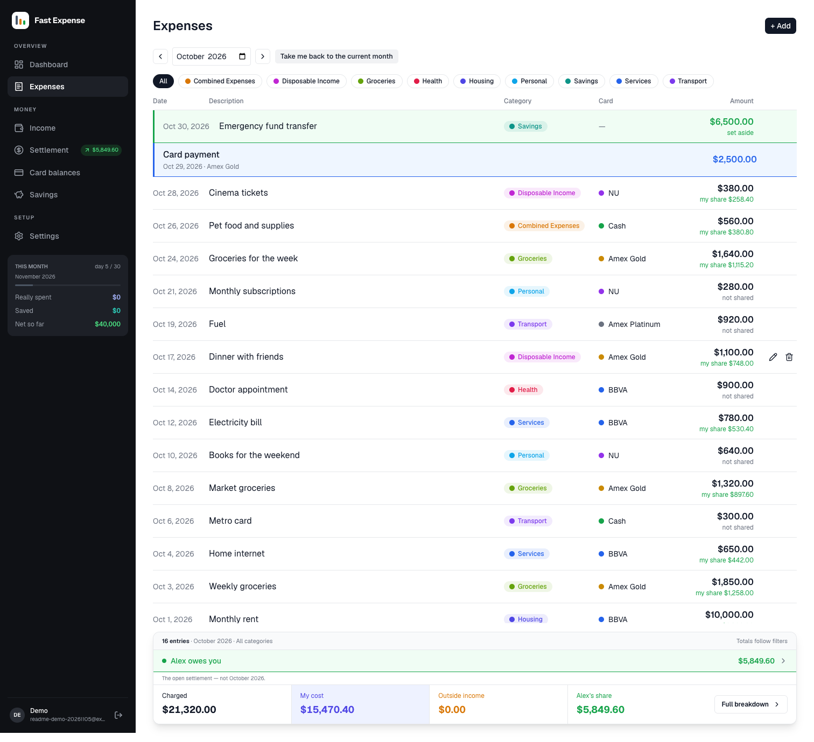
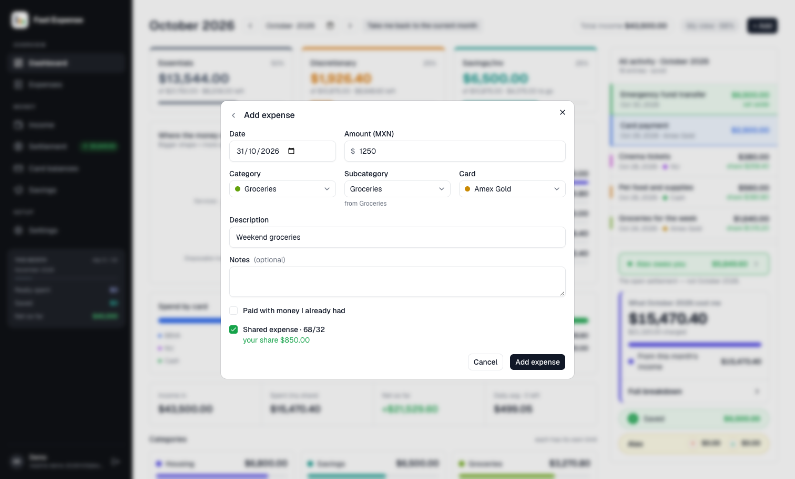
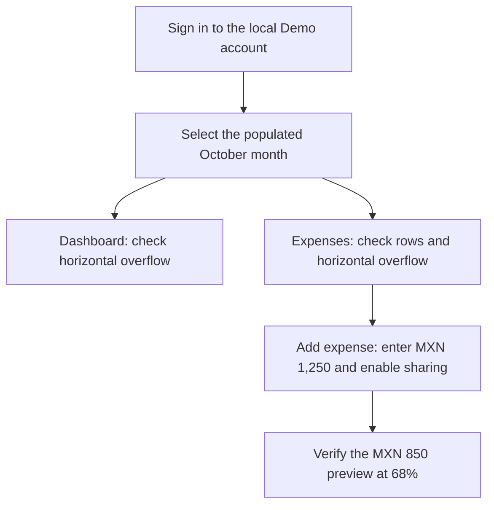

# Example PR body

This example reformats the verification from [PR #108](https://github.com/Chrisgmsl22/fast-expense-tracker/pull/108) and reuses its three screenshots. The Mermaid diagram is included here to show how a PR can document a workflow.

## Summary

- Update the README to describe the shipped app and the local Docker setup.
- Add screenshots of the dashboard, expenses list, and shared-expense form so readers can see the app with demo data.

## Scope (in)

- Document authentication configuration, the database variable, and migration and seed order.
- Add three screenshots from the running app and document how to refresh them.

## Scope (out)

- Product behavior and database schema changes.

## Test plan

### Browser scenarios

Used the English app at `5a3d773`, with invented October 2026 data in a local Demo account. Captured the desktop browser at 1512 px wide. [Screenshot provenance](../screenshots/README.md)

1. **Dashboard.** Open the populated month and check that the dashboard fits the window. The dashboard rendered with no horizontal overflow.

    

2. **Expenses list.** Open the list for the same month and check that the demo rows render without horizontal overflow. The rows rendered and the page fit the window.

    

3. **Shared-expense preview.** Open Add expense and enter MXN 1,250 with sharing enabled. The expected share at 68% was MXN 850. The form displayed MXN 850 before saving.

    

### Automated checks

- `pnpm test:coverage` passed with 2,306 tests across 158 files. The existing Vitest coverage-version warning remained.
- TypeScript, Prettier, Git diff, local link, and image path checks passed.
- The recorded browser checks cover desktop. The PR did not record mobile verification or a fresh Docker setup run.

## Notes

The diagram shows how the README screenshots were verified.

