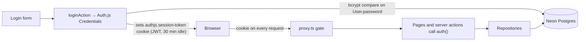
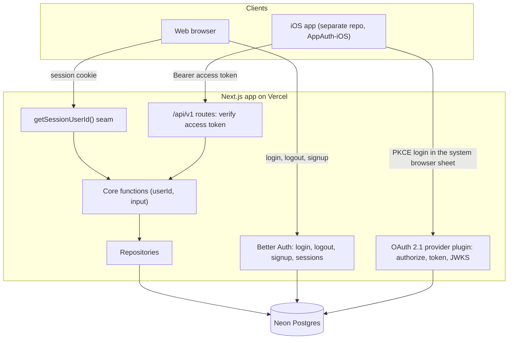
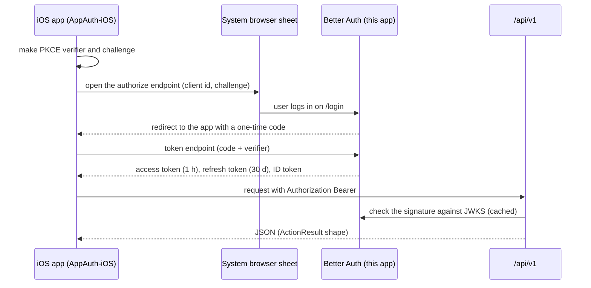
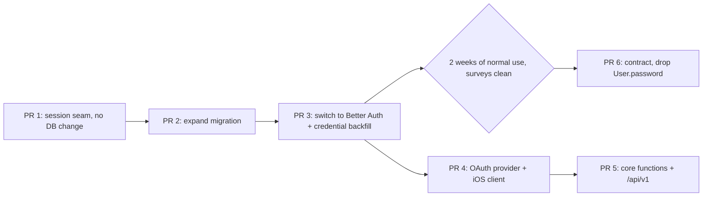

# 0009: Auth module on Better Auth, ready for an iOS client

**Date**: 2026-10-16
**Status**: Accepted (owner sign-off 2026-10-16); implementation pending
**Type**: Platform / auth migration
**Chores**: CHORE-39 (PR 1) → CHORE-40 (PR 2) → CHORE-41 (PR 3) → CHORE-42 (PR 4); CHORE-43 (PR 6) after the waiting period. PR 5 (`/api/v1`) is registered when the iOS work starts. See [`chores.json`](../roadmap/chores.json).
**Relates**: [ADR-0009](../decisions/0009-login-credential-security.md), [ADR-0026](../decisions/0026-gate-public-signup-behind-global-config.md), BUG-3 (idle session), CHORE-8.e, CHORE-32, CHORE-33, CHORE-34, CHORE-36
**Decisions**: [ADR-0027](../decisions/0027-replace-authjs-with-better-auth.md) (Better Auth, self-hosted) and [ADR-0028](../decisions/0028-native-clients-use-oauth-with-pkce.md) (native clients use OAuth 2.1 with PKCE, RFC 8252).

We move the login system from Auth.js to Better Auth. It stays inside this app, and users stay in
Neon. The web keeps a cookie session. A future iOS app (its own repo, its own spec) logs in through
the standard OAuth flow with PKCE and calls a new `/api/v1`. The first rule is data safety: no money
table changes, no user id changes, and every step can roll back until the final cleanup. The work is
6 PRs. PRs 1 to 3 move the web, PRs 4 and 5 open the door for the phone, and PR 6 cleans up after a
waiting period.

---

## 1. Why

- A native app cannot use the current login. Auth.js reads only a browser cookie, and its
  Credentials flow expects a browser (CSRF token, redirects).
- Auth.js has no native-app support and gets security fixes only since the Better Auth team took it
  over (22 September 2025). We run `next-auth 5.0.0-beta.31`.
- Better Auth has the parts we would otherwise write by hand: database sessions, a rate limiter, and
  an OAuth 2.1 provider with PKCE, JWKS and refresh-token rotation.

## 2. Data-safety rules

These rules bind every PR in this spec. A reviewer rejects a PR that breaks one.

1. **No money table changes.** No migration here touches `Expense`, `Movement`, `Income`, `Card`,
   `Category`, `Subcategory`, `CategoryBudget`, `BudgetRule` or `Settings`.
2. **No identity changes.** `User.id`, `User.email` and every foreign key to `User` stay as they
   are. All 9 foreign keys are `ON DELETE RESTRICT ON UPDATE CASCADE`, so an id change would ripple.
3. **Expand first, contract last.** PRs 2 to 5 only add tables, add columns, or relax a constraint.
   The only destructive step (drop `User.password`) is PR 6, after a waiting period.
4. **Idempotent, guarded backfill.** The credential copy is `INSERT ... WHERE NOT EXISTS`, runs in one
   transaction, and ends with a guard that raises an exception when counts do not match. The error
   text holds counts only, no emails, because it lands in the Vercel build log.
5. **Tested on invented data.** Every migration with data logic has an integration test that runs its
   SQL against fixture users, as `email-case-migration` does today.
6. **A restore point before each prod step.** Christian takes a Neon restore point before he merges
   PR 2, PR 3 and PR 6, because merging deploys and `vercel.json` runs `prisma migrate deploy`. A
   Vercel rollback does not undo a schema change.
7. **Surveys before and after.** A runbook in `docs/operations/better-auth-migration.md` holds
   read-only SELECTs (user count, credential-account count, users without a credential account).
   Christian runs them. The agent never connects to production.
8. **Old code keeps working until PR 6.** `User.password` keeps every hash, so a rollback to the
   Auth.js build can still log users in.

## 3. Current system



- The session is a JWT in a cookie. No session row exists in the database.
- The 30-minute idle rule lives in the `jwt` callback (`auth.config.ts`), `IdleSessionGuard`, and
  `passiveSessionResponse`, which strips cookie writes from passive reads.
- 45 non-test files import `next-auth` or `@/auth`. About 40 tests mock `auth()`.

## 4. Target system



- **One identity provider, two clients.** The web uses a first-party cookie session. The iOS app is a
  registered public OAuth client. Both log in on the same `/login` page.
- **One seam for the user id.** Pages and actions call our own `getSessionUserId()`, not the library.
  Tests mock the seam. A later library change touches one file.
- **Same core for web and API.** Server actions and `/api/v1` routes call the same core functions.
  The money rules stay on the server; the phone never calculates `actualExpenditure`.

How the iOS app logs in:



Token lifetimes are the plugin defaults. Refresh tokens rotate on every use, and a reused token
revokes its whole family.

## 5. Schema changes

| Change                                        | PR  | Kind             | Existing rows                                                                                 |
| --------------------------------------------- | --- | ---------------- | --------------------------------------------------------------------------------------------- |
| `account` table                               | 2   | add              | Empty in PR 2. PR 3 adds 1 credential row per user with the hash copied from `User.password`. |
| `session`, `verification`, `rateLimit` tables | 2   | add              | Empty                                                                                         |
| `User.emailVerified Boolean @default(false)`  | 2   | add column       | `false`. Email verification stays off.                                                        |
| `User.image String?`                          | 2   | add column       | `null`                                                                                        |
| `User.password` to nullable                   | 2   | relax constraint | Values unchanged. New Better Auth users have no hash on `User`.                               |
| `jwks` and OAuth provider tables              | 4   | add              | Empty                                                                                         |
| Drop `User.password`                          | 6   | contract         | Removed after the waiting period                                                              |

Model names stay as they are (`User`). Better Auth maps to them through the Prisma adapter's model
name. New ids use `advanced.database.generateId: "uuid"`, which matches the current UUID text ids.
The default (base62) would create a second id format.

## 6. Behavior we keep

| Behavior                     | Today                                                                  | After                                                                                                                                                        |
| ---------------------------- | ---------------------------------------------------------------------- | ------------------------------------------------------------------------------------------------------------------------------------------------------------ |
| Login errors                 | "Invalid email or password." for both unknown email and wrong password | Same text. Our action maps the library error.                                                                                                                |
| Legacy short passwords       | `loginSchema` accepts them on purpose                                  | Must still log in. Strength rules stay in our `signupSchema`, not in the library's sign-in check.                                                            |
| Hashing                      | bcryptjs, cost 10                                                      | `emailAndPassword.password.hash` and `verify` call bcryptjs, cost 10                                                                                         |
| Email case                   | Stored and looked up lowercased                                        | Our schemas still normalize before every library call                                                                                                        |
| 30-minute idle               | JWT idle claim, renewed only by real activity                          | Session row with `expiresIn: 1800` and `disableSessionRefresh: true`. The renewal action moves `expiresAt` only on real activity. Passive reads never renew. |
| Expired notice               | Redirect to `/login?reason=session-expired`                            | Same. The cookie name in the proxy check changes.                                                                                                            |
| Cross-tab sync, session lock | `IdleSessionGuard`, `session-lock`                                     | Kept. Only the calls into the library change.                                                                                                                |
| Signup gate and cap          | ADR-0026                                                               | Same order: our action checks the gate and the cap, then calls the library                                                                                   |
| Signup is dark               | Off until CHORE-8.e, 32, 33                                            | Unchanged                                                                                                                                                    |

The BUG-3 tests (`auth-session-window`, `idle-session-*`, `passive-session-response`) are the
contract for the idle rule. PR 3 rewrites their internals and keeps their `it` titles.

What gets better: a session is now a row, so logout can end every session for a user. CHORE-33
(change password) and CHORE-36 (delete account) need that.

## 7. Migration sequence and rollback



| PR   | If it goes wrong                                                                                                                           |
| ---- | ------------------------------------------------------------------------------------------------------------------------------------------ |
| 1    | Revert. No data change.                                                                                                                    |
| 2    | Revert the code. The new tables and columns are unused by Auth.js and can stay.                                                            |
| 3    | Vercel rollback to the PR 2 build. `User.password` still holds every hash (rule 8), so Auth.js logs users in. Everyone logs in again once. |
| 4, 5 | Revert. The new tables are unused by the web.                                                                                              |
| 6    | Only the Neon restore point. That is why it waits.                                                                                         |

**Password writes during the window.** Between PR 3 and PR 6, a password set through Better Auth
lands in `account`, not in `User.password`. Then a rollback would lose it. Two ways to close this:
mirror the hash to `User.password` in a database hook, or ship no password-writing feature (open
signup, CHORE-33) before PR 6. §10 asks which one the library supports.

## 8. Decomposition

| #   | PR                             | Contents                                                                                                                                                                                                                                                                | Needs                            |
| --- | ------------------------------ | ----------------------------------------------------------------------------------------------------------------------------------------------------------------------------------------------------------------------------------------------------------------------- | -------------------------------- |
| 0   | `fet-docs-auth-module-spec`    | This spec, ADR-0027, ADR-0028, the runbook skeleton, chore entries                                                                                                                                                                                                      | Sign-off                         |
| 1   | `fet-chore-session-seam`       | `getSessionUserId()` in `lib/auth`. Replace `auth()` in the 7 pages, the layout and the 30 data actions. Tests mock the seam. No behavior change.                                                                                                                       | 0                                |
| 2   | `fet-chore-auth-expand-schema` | The §5 PR 2 rows. Migration test. Runbook surveys.                                                                                                                                                                                                                      | 1                                |
| 3   | `fet-chore-better-auth-switch` | Better Auth config, `app/api/auth/[...all]`, login, logout, signup and renew actions, proxy gate, `IdleSessionGuard` client calls, credential backfill with guard, rate limit with `storage: "database"`, remove `next-auth`. Reviewer review and a real-browser check. | 2, restore point                 |
| 4   | `fet-feat-oauth-provider`      | `jwt()` and `oauthProvider()` plugins, their tables, the consent page, the iOS client registration (public, PKCE, private-use redirect URI)                                                                                                                             | 3                                |
| 5   | `fet-feat-api-v1`              | Core functions out of the actions. `/api/v1` read and write routes. Access-token check. OpenAPI document for the Swift client.                                                                                                                                          | 4                                |
| 6   | `fet-chore-auth-contract`      | Drop `User.password`. Remove the dual-write hook. Update `seed.ts`.                                                                                                                                                                                                     | 3, waiting period, restore point |

Every PR follows the Full Plan rule (`slice-planning.md`), because each one touches auth or a
migration. Schema PRs stay separate from code PRs, except PR 3: there the backfill must deploy
with the new code, or a user created in between would have no credential row.

## 9. Overlap with other work

- **CHORE-8.e (onboarding wizard), open.** It adds `User.onboardedAt` and a `jwt` callback branch
  for the display name. Land it before PR 1. PR 3 then removes that branch, because the name comes
  from the user row.
- **CHORE-32 (rate limit login and signup).** PR 3 turns on the Better Auth limiter with database
  storage. That covers CHORE-32's scope. Its ADR (revisiting ADR-0009) can ship with PR 3.
- **CHORE-33 (change password).** Build it on `auth.api.changePassword` after PR 3. Ship it after
  PR 6, unless the dual-write hook exists.
- **CHORE-34 (backup runbook).** Land it before PR 2. Rule 6 depends on it.
- **CHORE-36 (delete account).** Better Auth's delete cannot pass the `RESTRICT` foreign keys. It
  stays our own flow.
- **Seed.** `prisma/seed.ts` and `user-provisioning.repository.ts` write `User.password` directly.
  PR 3 makes them also write the credential row. PR 6 drops the old write.

## 10. Open questions (answer before PR 3 starts)

1. Does Better Auth check the minimum password length at sign-in? If yes, set it low and keep the
   strength rules in `signupSchema`, or the owner's legacy password stops working.
2. Can a database hook on `account` create and update mirror the hash to `User.password`? The docs
   show only the `user` hook shape.
3. Signup today creates the user and the starter kit in one transaction. With the library creating
   the user, how do we keep that atomic? Options: a `user.create.after` hook, or an idempotent
   `provisionNewUser` that runs again on first login.
4. Does the idle design hold: `disableSessionRefresh: true` plus our own renewal that moves
   `expiresAt`? Check that no library read extends the session.
5. Which Better Auth version to pin. The 1.7 line has the OAuth provider and removes the old OIDC
   plugin. Pin an exact 1.7.x that is at least 2 weeks old.
6. Does the Prisma adapter work with Prisma 6 and our `User` model name without renaming tables?
7. Does AppAuth-iOS still get regular releases? If not, the iOS spec picks a maintained client.

## 11. Out of scope

- The iOS app itself. It gets its own repo and its own spec.
- Face ID, Sign in with Apple, Google login, passkeys, email verification, 2FA.
- Opening public signup.
- Fixing `docs/conventions/deployment.md`, which still says the repo has no `vercel.json`. That is a
  separate docs fix.

## 12. References

- [RFC 8252: OAuth 2.0 for Native Apps](https://rfc-editor.org/rfc/rfc8252)
- [Better Auth: migrating from Auth.js](https://better-auth.com/docs/guides/next-auth-migration-guide)
- [Better Auth: OAuth 2.1 Provider plugin](https://better-auth.com/docs/plugins/oauth-provider)
- [Better Auth: options reference](https://better-auth.com/docs/reference/options)
- [Auth.js is now part of Better Auth](https://github.com/nextauthjs/next-auth/discussions/13252)
- Runbook precedents: `docs/operations/per-user-categories-migration.md`,
  `docs/operations/partner-payment-conversion-migration.md`

## For agents

**Backfill shape (PR 3).** Column names follow the Prisma models that PR 2 generates.

```sql
INSERT INTO "account" ("id", "userId", "accountId", "providerId", "password", "createdAt", "updatedAt")
SELECT gen_random_uuid()::text, u."id", u."id", 'credential', u."password", now(), now()
FROM "User" u
WHERE u."password" IS NOT NULL
  AND NOT EXISTS (
    SELECT 1 FROM "account" a
    WHERE a."userId" = u."id" AND a."providerId" = 'credential'
  );

DO $$
DECLARE users_with_hash int; credential_rows int;
BEGIN
  SELECT count(*) INTO users_with_hash FROM "User" WHERE "password" IS NOT NULL;
  SELECT count(*) INTO credential_rows FROM "account" WHERE "providerId" = 'credential';
  IF credential_rows < users_with_hash THEN
    RAISE EXCEPTION 'credential backfill mismatch: % users with a hash, % credential rows',
      users_with_hash, credential_rows;
  END IF;
END $$;
```

**Files PR 3 touches.** `auth.ts`, `auth.config.ts`, `proxy.ts`, `types/next-auth.d.ts` (delete),
`app/api/auth/*`, `app/_actions/auth/*`, `lib/auth/*`, `components/auth/IdleSessionGuard.tsx`,
`lib/services/user/user.service.ts` (becomes a repository per `coding-conventions.md`),
`lib/repositories/user-provisioning.repository.ts`, `prisma/seed.ts`.

**Regression net.** Unit: `auth-entry-points`, `auth-login`, `auth-schema`, `auth-session-window`,
`idle-session-client`, `idle-session-guard`, `idle-session-login-race`, `passive-session-response`,
`signup-action`, `seed`. Integration: `user-service`, `user-provisioning-repository`, `seed`, plus the
new migration test. The e2e login suites do not run in CI, so PR 3 needs a real-browser check.
