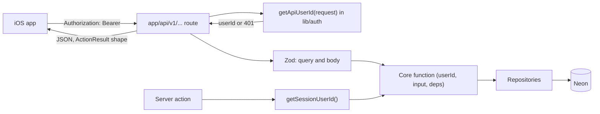

# 0014: `/api/v1` for the iOS app

**Date**: 2026-11-27
**Status**: Draft (owner sign-off pending; see §12)
**Type**: API design
**Chores**: CHORE-53 → CHORE-54 → CHORE-55, then CHORE-56 to CHORE-59 in any order. See [`chores.json`](../roadmap/chores.json).
**Relates**: [spec 0009](./0009-auth-module-better-auth.md) PR 5, [ADR-0028](../decisions/0028-native-clients-use-oauth-with-pkce.md), CHORE-42, [ADR-0015](../decisions/0015-layered-architecture-and-di.md)
**Data**: [route and screen tables](../reference/api-v1-routes.md)

The Swift iOS app cannot call server actions, and today every read and write goes through one. This
spec designs the `/api/v1` that spec 0009 names as PR 5: the route list, how a route finds the user,
the response shape, money, dates, retries, the OpenAPI document and the versioning rule. It splits
PR 5 into 7 chores. The first one serves the dashboard summary, which needs no code moved out of an
action, so the phone can show real data soon after sign-in works. The route list and the screen map
live in the [data file](../reference/api-v1-routes.md). Five choices in §12 need Christian's answer.

---

## 1. What the phone needs

The iOS designs have 103 screens: 13 Kept, 48 Adjusted, 42 New or Proposal. v1 serves every Kept
and Adjusted screen with the reads and writes the web has today. A New or Proposal screen waits for
its FET feature; that feature's PR adds its routes to v1. The data file maps each screen to its
routes and each waiting screen to the chore that owns it.

v1 adds no money feature. Every route reuses an action, a service or a repository that the web
already runs.

## 2. Shape of a request

- A route file under `app/api/v1/` only parses, calls one core function and maps the result to
  HTTP. It holds no logic, the same rule as an action.
- `proxy.ts` skips every `/api` path, so the route gate is the route itself. Every handler goes
  through one wrapper (`lib/api/v1/handler.ts`) that resolves the user before it does anything
  else. A unit test lists every `route.ts` under `app/api/v1/` and fails when one skips the wrapper.
- Every response carries `Cache-Control: private, no-store`, as `/api/financial-export` does.
- No CORS headers. The only client is a native app.

## 3. The user id: one seam, two readers

`lib/auth/session.ts` owns the user id today. `getSessionUserId()` reads the web cookie. The auth
readiness item (`fet-feat-mobile-auth-contract`, spec 0009 delivery plan step 7) adds the second
reader next to it:

- `getApiUserId(request): Promise<string | null>` checks the bearer token's signature against
  JWKS, then the issuer, the audience, the expiry and the `fet:api` scope. It refuses an ID token.
  It returns the `sub` claim, which is `User.id`.
- `/api/v1` accepts the bearer token only. It ignores the web cookie, so a browser cannot be tricked
  into a cross-site write.

Core functions take `userId` as their first argument. Actions keep calling `getSessionUserId()`,
then the core function. Routes call `getApiUserId(request)`, then the same core function. Tests mock
the two seams, as they mock `getSessionUserId()` today.

Four read services already take `userId` first: `getDashboardSummary`, `getCategoryDetail`,
`getSettlement` and `loadOnboarding`. Every write still reads the session inside the action. Each
chore moves the writes it needs into `lib/core/<area>/` with the existing logic, checks and logs
unchanged, and makes the action a thin caller.

**Ownership checks move with the logic.** The repositories trust the `categoryId`, `subcategoryId`
and `cardId` they get; the actions check that the user owns them. The core functions keep those
checks, and each write chore adds a test that another user's ids are refused with `not_found`.

## 4. Response and error shape

Spec 0009 says JSON in the `ActionResult` shape. This spec keeps it and adds HTTP status codes.

- Success: `{ "ok": true, "data": ... }` with 200, or 201 for a created row.
- Failure: `{ "ok": false, "code": "...", "message": "...", "fieldErrors": { "field": ["..."] } }`.
  `fieldErrors` appears only with `validation`.

| Status | Codes                                                                                                                                                         |
| ------ | ------------------------------------------------------------------------------------------------------------------------------------------------------------- |
| 400    | `validation`                                                                                                                                                  |
| 401    | `unauthenticated`, with `WWW-Authenticate: Bearer error="invalid_token"`. The app refreshes once, then shows "Session ended"                                  |
| 403    | `insufficient_scope`                                                                                                                                          |
| 404    | `not_found`. Also for a row that belongs to another user, so an id never proves that a row exists                                                             |
| 409    | `cycle_closed`, `duplicate_name`, `name_conflict`, `limit_reached`, `has_references`, `cash_locked`, `not_settled`, `no_marker`, `marker_gone`, `id_conflict` |
| 500    | `server_error`. The core function logs the cause as the action does today                                                                                     |

**Why keep the body shape when HTTP has status codes.** The web and the API then share one result
type, and the `code` survives a proxy that rewrites status codes. The app branches on `code`, never
on `message`.

**Language.** Actions translate `message` from the `NEXT_LOCALE` cookie. Routes take the locale
from `Accept-Language` (`es` or `en`, else the web default). The app may show `message` as is.

## 5. Money

- The server returns every money value the phone shows: `amount`, `actualExpenditure`,
  `partnerShare` (`amount − actualExpenditure` on a shared row, else 0), every total, balance,
  target, remaining and percent.
- The phone never sends `actualExpenditure`. The core function computes and stores it, as today.
- The phone sends `amount`, `isShared` and `yourPercentage`; the server picks the rest of the
  split from the stored row and the settings.
- Values are MXN. `GET /settings` returns `currency: "MXN"` so the app does not hard-code it.
- **Previews.** Some designs show a figure before save: the share in the Add form, "balance →
  after" on a payment sheet, pending rows in the chin. These are display hints the phone computes
  from server values. After the write returns, the phone shows only the server's numbers. A test in
  the iOS repo never asserts a total the app computed. (§12 decision 5.)
- Wire format: a JSON number rounded to 2 decimals (§12 decision 1).

## 6. Dates, months and lists

- **Calendar date** (expense, income, movement): `YYYY-MM-DD`, both ways. The server refuses a
  timestamp. Today `z.coerce.date` accepts one, and an offset can move the stored day.
- **Instant** (`createdAt`, `archivedAt`, `closedAt`, `onboardedAt`): ISO 8601 in UTC with `Z`.
- **Month**: `?month=YYYY-MM`. Absent means the current Mexico City month. A future month is a
  `validation` error. The web clamps it, but an API that silently changes the asked month hides
  bugs.
- **Time zone**: `America/Mexico_City`, fixed UTC-6. `GET /settings` returns it.
- **Paging**: none in v1. Every list is one month, one open settlement cycle or one card's month,
  so it stays small. Adding paging to an existing list later is a breaking change (§9), so it
  comes as a new route or a new opt-in parameter.
- **Order**: newest first by `date`, then `createdAt`, then `id`. Today rows of the same day sort
  in database order. The read chores add the tiebreak, which also fixes the web.

## 7. Retries and offline writes

The designs show optimistic rows and an offline queue (iOS Brief 4). The queue replays a write
after a lost response, so every write must be safe to send twice.

**Creates take a client id.** Each `POST` that creates a row accepts an optional `id`, a UUID the
app makes when the row first appears on screen. Every model's id is already a UUID string, so no
migration is needed.

- New id: the row is created with that id. 201.
- Same id, same user: the server returns the stored row. 200. Nothing is written.
- Same id, another user: `id_conflict`, 409, with no data.
- No id: the server makes one, as today. The web keeps working unchanged.

**Other writes.**

| Write                                 | On a repeat                                                                  |
| ------------------------------------- | ---------------------------------------------------------------------------- |
| `PUT` and `PATCH`                     | Same values, same result                                                     |
| `DELETE`                              | 404 the second time. The queue treats 404 on a delete as done                |
| `POST /settlement/close`              | `alreadyClosed: true`, as the action does today                              |
| `POST /onboarding/complete`           | Keeps the first timestamp                                                    |
| `POST /cards/{id}/archive`, `restore` | 409 the second time. The queue treats it as done after it reads `GET /cards` |

**Conflicts between devices.** Last write wins, as on the web today. v1 has no ETag. A later version
can add `If-Match` as an opt-in header.

## 8. OpenAPI document

- Each route declares one entry in `lib/api/v1/contract.ts`: method, path, query schema, body
  schema, response `data` schema and its failure codes. The handler and the document read the same
  entry, so they cannot drift.
- Request schemas reuse the Zod schemas in `lib/schemas/`, with the date fields swapped for the
  strict `YYYY-MM-DD` schema. Response schemas are new Zod schemas next to them.
- `pnpm api:openapi` turns the entries into an OpenAPI 3.1 document with `z.toJSONSchema`
  (zod 4.4.3 is installed). It writes `docs/api/openapi-v1.json`, which is committed.
- A unit test regenerates the document and fails when the committed file differs. A contract test
  per route parses the handler's real response with its schema.
- `GET /api/v1/openapi.json` serves the committed file without a token.
- The iOS repo copies the file at a FET commit and generates its client from it. Its ADR-0004
  picks the generator. Each FET PR that changes the document says so in its PR body.

## 9. Versioning

Old app builds stay on phones (ADR-0028). v1 changes only in ways an old build survives.

**Allowed in v1:** a new route; a new optional request field; a new response field; a new failure
code on a path that could not fail before, when the status is one from §4; a looser validation rule.

**Breaking, needs `/api/v2`:** removing or renaming a route or a field; changing a field's type,
unit or meaning; a new required request field; a tighter validation rule; a new value in a response
enum; a different status or `code` for the same case; paging an existing list.

The app must ignore response fields it does not know and treat an unknown `code` by its status.
When v2 exists, v1 stays until no supported build calls it.

## 10. Delivery

Seven PRs. Each one ships alone, adds routes, and leaves the web unchanged. CHORE-53 needs
CHORE-42 and the auth readiness item merged. Every later chore needs only CHORE-53 merged, so
CHORE-56 to CHORE-59 can run in parallel after CHORE-55, each in its own worktree.

| #   | Chore    | PR title                         | Contents                                                                                                                                            | Serves                                   |
| --- | -------- | -------------------------------- | --------------------------------------------------------------------------------------------------------------------------------------------------- | ---------------------------------------- |
| 1   | CHORE-53 | `fet-feat-api-v1-foundation`     | The wrapper, error mapping, month and date schemas, the contract file, the OpenAPI script and test, `GET /dashboard` (summary), `GET /openapi.json` | Dashboard top. **First real data**       |
| 2   | CHORE-54 | `fet-feat-api-v1-expense-reads`  | `GET /feed` with filter and search, `GET /expenses/{id}`, `GET /categories`, `GET /cards`, `GET /settings`, the sort tiebreak                       | Expenses list, the Add form's pickers    |
| 3   | CHORE-55 | `fet-feat-api-v1-expense-writes` | Core functions for expense and partner-payment writes, client ids on create, the cross-user id tests                                                | Add, edit, delete expense                |
| 4   | CHORE-56 | `fet-feat-api-v1-category`       | `GET /categories/{slug}`, `PUT /categories/{slug}/budget`, the breakdown fields on `GET /dashboard`                                                 | Category detail, limit sheet, month rail |
| 5   | CHORE-57 | `fet-feat-api-v1-settlement`     | Movement reads and writes, `GET /settlement`, `POST /settlement/close`                                                                              | Settlement, payment sheets               |
| 6   | CHORE-58 | `fet-feat-api-v1-money`          | Income reads and writes, card balances, card history                                                                                                | Income, card balances, card detail       |
| 7   | CHORE-59 | `fet-feat-api-v1-settings`       | `PATCH /me`, onboarding, card writes, split and budget rule writes, `GET /financial-export` with a bearer token                                     | Settings, onboarding                     |

**What CHORE-53 needs from CHORE-42** (merged and deployed):

- Access tokens are JWTs with the issuer, an audience for `/api/v1`, an expiry and the scopes.
  If the plugin issues a JWT only for a requested `resource`, the client contract says so.
- The `fet:api` scope exists and the iOS client may request it.
- A JWKS endpoint that the route can reach.

**What CHORE-53 needs from the auth readiness item** (merged):

- `getApiUserId(request)` in `lib/auth`, with its tests (§3).
- `GET /api/v1/me` and the written client contract.

If the auth readiness item is late, CHORE-53 can still merge with its tests on the mocked seam.
The phone shows real data only when both are deployed.

## 11. Out of scope

- Routes for New and Proposal screens. Each comes with its feature (data file §3).
- Rate limits on `/api/v1`. Better Auth limits only its own endpoints. Add one if logs show abuse.
- Push, widgets, a delta sync route.
- Any change to how money is counted.

## 12. Decisions for Christian

1. **Money on the wire.** (a) JSON number with 2 decimals, the same as the database `Float`
   values. (b) A decimal string such as `"1250.50"`. **Recommend (a).** The server already rounds
   to cents, and the app formats the number; (b) adds a parse on both sides for no gain today.
2. **Retry safety.** (a) A client-made UUID on create (§7). (b) An `Idempotency-Key` header and a
   new table of stored responses. **Recommend (a).** It needs no table and no migration, and the
   optimistic row already has an id.
3. **Scopes.** (a) One scope, `fet:api`. (b) Three scopes that match the consent screen's three
   groups (money, settlement, settings). **Recommend (a).** The only client is our own app and the
   consent is all or nothing, so three scopes protect nothing. The consent page can still show
   three lines.
4. **Who builds the token check and `/me`.** (a) The auth readiness item, as the delivery plan
   says. Register it now as a chore. (b) Fold both into CHORE-53. **Recommend (a).** Auth stays in
   one track and CHORE-53 stays small.
5. **Previews on the phone.** (a) The phone may compute display-only previews from server values
   before a save (§5). (b) Every preview comes from a server preview route. **Recommend (a).** The
   stored numbers still come only from the server, and (b) adds a round trip to every keystroke.

## For agents

- The read and write inventory behind the data file came from `app/_actions/**`,
  `lib/services/**`, `lib/repositories/**` and the pages under `app/(dashboard)/`.
- `ActionResult` is in `lib/actions/result.ts`. The seam is `lib/auth/session.ts`.
- Known bug to fix while extracting `setCategoryBudget`: `categoryRepo.getBySlug` sits outside the
  `try` (`app/_actions/category/set-budget.ts:81`), so a database error throws instead of
  returning `db_error`.
- `addCard` returns no id because `CardRepository.create` returns `void`. CHORE-59 changes it to
  return the row.
- `updateCardPayment` has no freeze check while the other movement updates do. Keep the behavior
  in the extraction and log it as a question, not a fix.
- Every stored calendar date is `T06:00:00.000Z` (`cdmxCalendarDateToUtc`). The API date schema
  must produce the same value.
